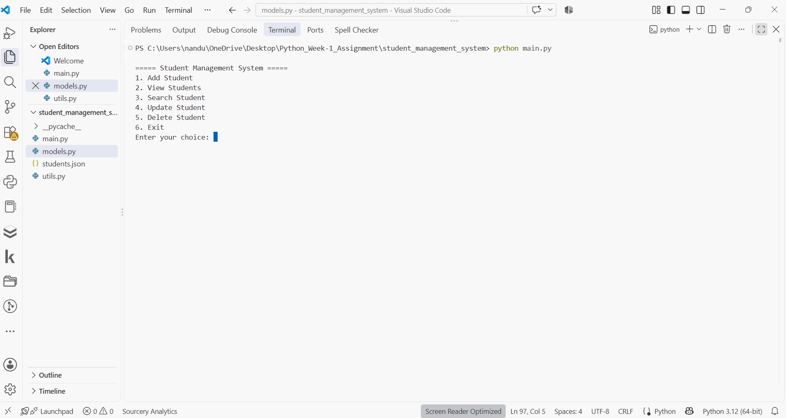
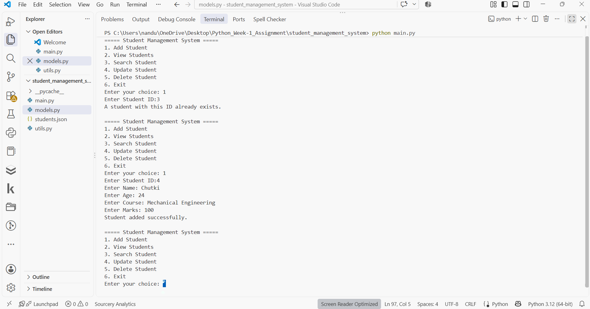
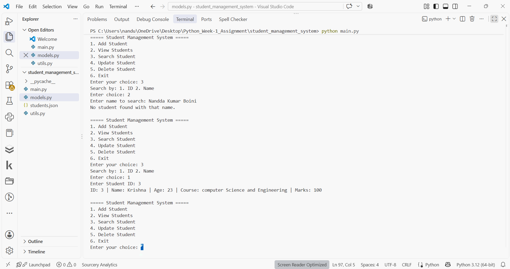
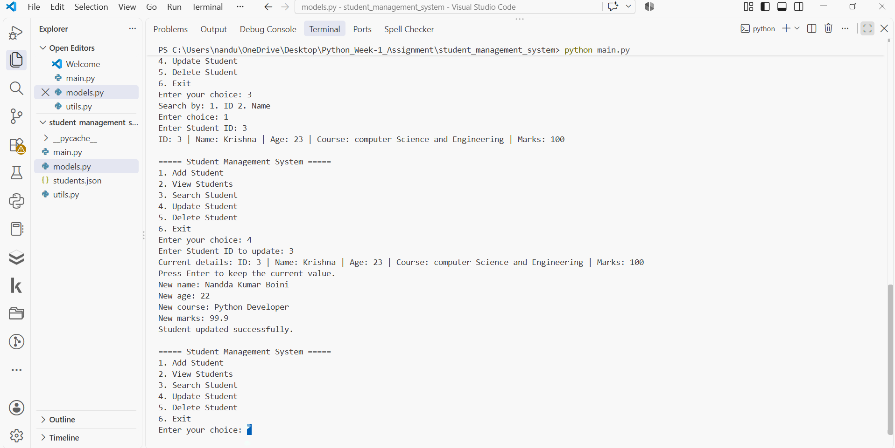
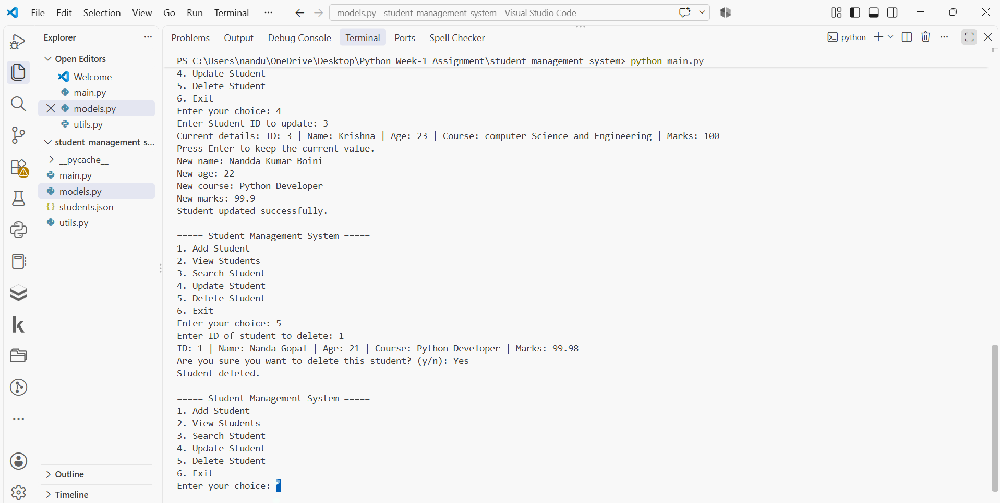
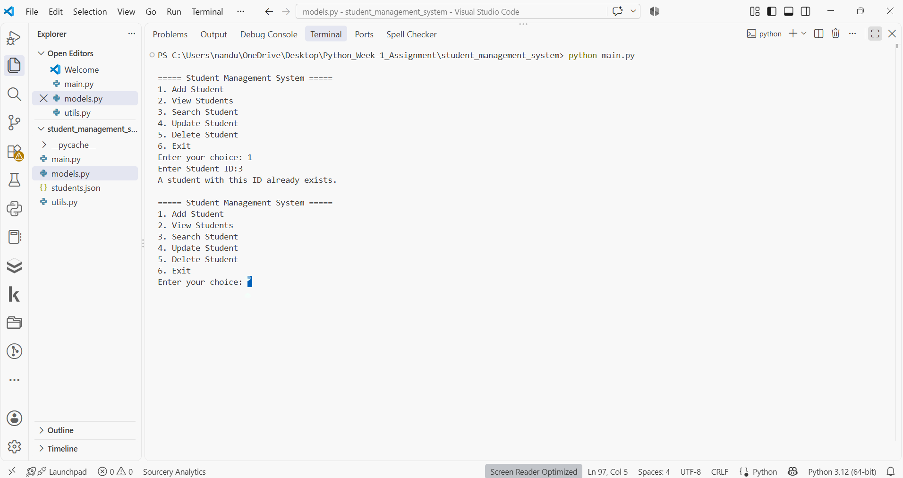

# Student Management System

## Objective
A console-based Python application to manage student records through a menu-driven interface. It demonstrates object-oriented programming, CRUD operations, input validation, exception handling, and file handling (JSON).

## Features
- Add a new student (ID, Name, Age, Course, Marks)
- View all students in a readable format
- Search a student by ID or by name (partial, case-insensitive)
- Update one or more fields of a student (press Enter to keep the old value)
- Delete a student after confirmation
- Input validation for numbers, empty fields, and duplicate IDs
- Data saved to `students.json` and reloaded when the program starts
- Safe exit from the menu

## Technologies Used
- Python 3
- JSON (built-in `json` module) for data storage
- VS Code and Git/GitHub

## Folder Structure
```
student_management_system/
├── main.py       # Menu and user interaction
├── models.py     # Student and StudentManager classes, file handling
├── utils.py      # Input validation helpers
├── screenshots/      # Screenshots used in this README
├── .gitignore
└── README.md
```
`students.json` is created automatically on first run.

## How to Run
1. Install Python 3 from python.org.
2. Open a terminal in the `student_management_system` folder.
3. Run:
   ```
   python main.py
   ```

## Sample Run
```
===== Student Management System =====
1. Add Student
2. View Students
3. Search Student
4. Update Student
5. Delete Student
6. Exit
Enter your choice: 1
Enter Student ID: 4
Enter Name: Chutki
Enter Age: 24
Enter Course: Mechanical Engineering
Enter Marks: 100
Student added successfully.
```

Updating a student:
```
Enter your choice: 4
Enter Student ID to update: 3
Current details: ID: 3 | Name: Krishna | Age: 23 | Course: computer Science and Engineering | Marks: 100
Press Enter to keep the current value.
New name: Nandda Kumar Boini
New age: 22
New course: Python Developer
New marks: 99.9
Student updated successfully.
```

Error handling (duplicate ID):
```
Enter your choice: 1
Enter Student ID: 3
A student with this ID already exists.
```

## Screenshots
| Main menu | Add student |
|---|---|
|  |  |

| Search by ID | Update student |
|---|---|
|  |  |

| Delete student | Error handling |
|---|---|
|  |  |

## Design Notes
- `Student` holds the data of one student.
- `StudentManager` holds the list and provides add, view, search, update, and delete methods, plus save/load.
- `utils.py` keeps validation separate from the menu logic.

## Author
BOINI NANDA KUMAR - Python Development Intern, WeIntern Pvt Ltd
